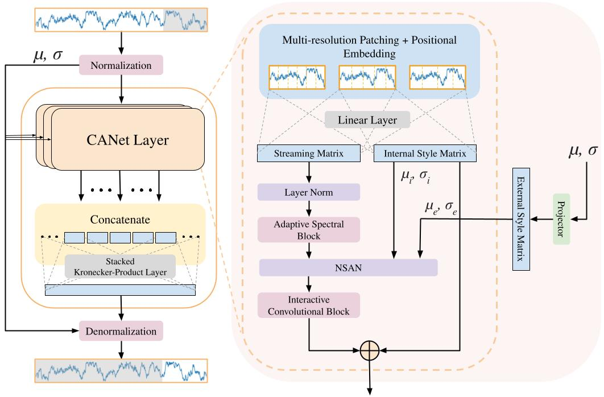

<h2> <p align="center"> CANet: ChronoAdaptive Network for Long-term Time Series Forecasting [Paper] [<a href="#citation">Cite</a>]
</p> </h2>

_**by: Sonmezer, M. & Ertekin, S.**_

### Abstract
---
<p align="center">
  
</p>

Long-term time series forecasting plays a pivotal role in various real-world applications. Despite recent advancements and the success of different architectures, forecasting is often challenging due to non-stationary nature of the real-world data, which frequently exhibit distribution shifts and temporal changes in statistical properties like mean and variance over time. Previous studies suggest that this inherent variability complicates forecasting, limiting the performance of many models by leading to loss of non-stationarity and resulting in over-stationarization (Liu et al., 2022). To address this challenge, we introduce a novel architecture, **C**horono**A**daptive **Net**work (CANet), inspired by style-transfer techniques. The core of CANet is the Non-stationary Adaptive Normalization module, seamlessly integrating the Style Blending Gate and Adaptive Instance Normalization (AdaIN) (Huang and Belongie, 2017). The Style Blending Gate preserves and reintegrates non-stationary characteristics, such as mean and standard deviation, by blending internal and external statistics, preventing over-stationarization while maintaining essential temporal dependencies. Coupled with AdaIN, which dynamically adapts the model to statistical changes, this approach enhances predictive accuracy under non-stationary conditions. CANet also employs multi-resolution patching to handle short-term fluctuations and long-term trends, along with Fourier analysis-based adaptive thresholding to reduce noise. A Stacked Kronecker Product Layer further optimizes the model's efficiency while maintaining high performance. Extensive experiments on real-world datasets validate CANet's superiority over state-of-the-art methods, achieving a 42% reduction in MSE and a 22% reduction in MAE.

### Datasets
---
Datasets used during the experiments can be obtained from the following repository: [-181717?logo=github&logoColor=white&style=for-the-badge)](https://github.com/thuml/Time-Series-Library)

### Citation
---
If you found this work useful, please consider citing it:
```bibtex
@article{canet2025,
  title     = {CANet: ChronoAdaptive Network for Long-term Time Series Forecasting},
  author    = {Mert Sonmezer and Seyda Ertekin},
  journal   = {Neural Networks},
  year      = {2025}
}
```

### Contact
---
If you have any questions or concerns, feel free to contact the following email: mert.sonmezer@metu.edu.tr or submit an issue.

### Acknowledgements
---
We appreciate the following papers and their repositories for providing valuable codebases:

| Papers     | Links                                     |
|------------|-------------------------------------------|
| TSLANet: Rethinking Transformers for Time Series Representation Learning | [](https://github.com/emadeldeen24/TSLANet) |
| A Time Series is Worth 64 Words: Long-term Forecasting with Transformers | [](https://github.com/yuqinie98/PatchTST)|
| Deep Adaptive Input Normalization for Time Series Forecasting | [](https://github.com/passalis/dain) |

