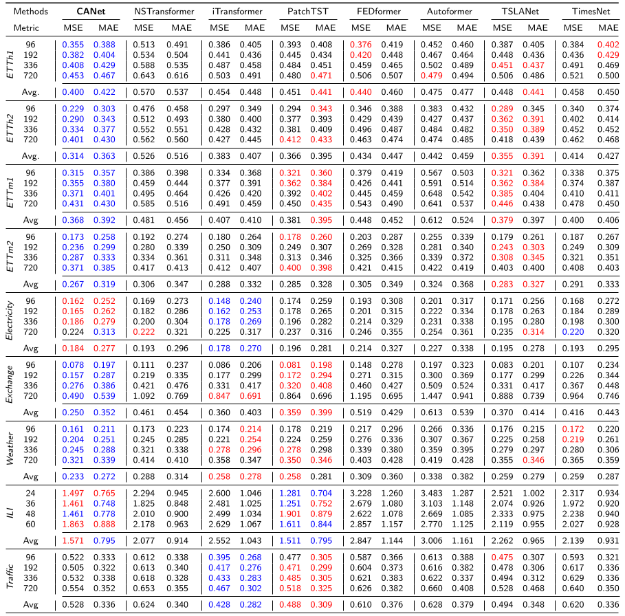

<h1 align="center">CANet: ChronoAdaptive Network</h1>
<h3 align="center">Long-term Time Series Forecasting</h3>
<p align="center">
  <a href="https://github.com/mertsonmezer/CANet/stargazers"></a>
  <a href="https://github.com/mertsonmezer/CANet/network/members"></a>
  <a href="https://github.com/mertsonmezer/CANet/issues"></a>
  <a href="https://github.com/mertsonmezer/CANet/blob/main/LICENSE"></a>
  <a href="https://doi.org/10.1016/j.neunet.2025.108495"></a>
  <a href="https://arxiv.org/abs/2504.17913"></a>
</p>
<p align="center">
  <b>Official implementation</b> |
  <a href="https://doi.org/10.1016/j.neunet.2025.108495">Paper (Neural Networks)</a> |
  <a href="https://arxiv.org/abs/2504.17913">arXiv</a> |
  <a href="#citation">Cite</a>
</p>
<p align="center">
  
</p>
<p align="center"><i>Figure: CANet's architecture tackles the challenge of non-stationarity in time series data</i></p>

## 🌟 Why CANet?
Real-world time series data is messy. Distribution shifts, temporal changes in statistical properties, and non-stationarity plague traditional forecasting models. While existing approaches struggle with these challenges, CANet thrives. CANet achieves breakthrough performance by:

* 🔄 Preserving non-stationarity through our innovative Style Blending Gate
* 🔍 Dynamically adapting to statistical changes with AdaIN
* 📊 Handling multi-scale patterns via multi-resolution patching
* 🔮 Reducing noise through Fourier analysis-based adaptive thresholding
* ⚡ Optimizing efficiency with Stacked Kronecker Product Layer

## 📈 Impressive Results
Extensive experiments on real-world datasets demonstrate CANet's superiority:

* 42% reduction in Mean Squared Error (MSE)
* 22% reduction in Mean Absolute Error (MAE)

Compared to state-of-the-art methods, CANet consistently delivers more accurate forecasts across diverse domains.

## 🛠️ Setup

**Prerequisites**
- Python ≥ 3.10
- CUDA-capable GPU recommended; CPU training is feasible but slow

**1. Install uv**
If you don't have [uv](https://docs.astral.sh/uv/) installed, follow the [official installation instructions](https://docs.astral.sh/uv/getting-started/installation/).

**2. Clone the repository**
```bash
git clone https://github.com/mertsonmezer/CANet.git
cd CANet
```

**3. Install dependencies**
```bash
uv sync
```

This creates a virtual environment and installs all required dependencies automatically. All commands below use `uv run` and do not require activating the virtual environment. To activate it manually for ad-hoc use:
```bash
source .venv/bin/activate
```

**4. Verify installation**
```bash
uv run python -c "import canet; print('Environment OK')"
```

## 🗂️ Project Structure

| Path | Description |
|---|---|
| `canet/canet.py` | `CANet` model and `TrainedCANet` Lightning wrapper |
| `canet/modules/nsan.py` | Non-Stationary Adaptive Normalization (Style Blending Gate + AdaIN) |
| `canet/modules/asb.py` | Adaptive Shift Block |
| `canet/modules/icb.py` | Input Correlation Block |
| `canet/modules/skp_layer.py` | Stacked Kronecker Product Layer |
| `canet/modules/patchifier.py` | Multi-resolution patchifier |
| `config/canet_config.py` | `CANetDataConfig` and `CANetTrainConfig` dataclasses |
| `data/` | Dataset loaders (ETT variants, custom CSV) and Fourier time-feature encoding |
| `forecasting/train.py` | Single-run training entry point |
| `forecasting/train_tune.py` | Optuna hyperparameter tuning entry point |
| `evaluation/inference.py` | Test-set inference, metrics, and optional visualization |
| `evaluation/analyze_study.py` | Optuna study statistics and confidence intervals |
| `evaluation/compute_model_complexity.py` | Parameter count and inference latency |
| `scripts/` | Ready-to-run bash experiments (one script per dataset) |
| `experiments/` | Auto-generated artifacts: checkpoints, `config.json`, `results.xlsx`, TensorBoard logs |

## 📊 Datasets

Download the benchmark datasets from:

[-181717?logo=github&logoColor=white&style=for-the-badge)](https://github.com/thuml/Time-Series-Library)

Place the CSV files under a `datasets/` directory at the repo root, matching the structure below:

```
datasets/
├── ETT-small/       # ETTh1.csv  ETTh2.csv  ETTm1.csv  ETTm2.csv
├── Electricity/     # electricity.csv
├── Exchange/        # exchange_rate.csv
├── ILI/             # illness.csv
├── Traffic/         # traffic.csv
└── Weather/         # weather.csv
```

> **Note on `--root_path`:** experiment scripts pass this path relative to the working directory (repo root). ETT/Electricity/Exchange/Traffic/Weather scripts use bare subdirectory names (e.g., `ETT-small/`); the ILI script uses the full `datasets/ILI/` prefix. Ensure your data layout matches these paths before running.

## 🧪 Experiments

<p align="center">
  
</p>
<p align="center"><i>Figure: CANet outperforms state-of-the-art models across multiple datasets and forecasting horizons</i></p>

The standard workflow is: **tune → train → evaluate**.

### 1. Hyperparameter tuning

Ready-to-run scripts are provided for all eight datasets. Each script loops over the four standard forecasting horizons (96 / 192 / 336 / 720) and runs 100 Optuna trials per horizon. The best checkpoint is automatically promoted to `experiments/{dataset}/tune/{study-name}/best/`.

```bash
bash scripts/etth1.sh       # ETTh1
bash scripts/etth2.sh       # ETTh2
bash scripts/ettm1.sh       # ETTm1
bash scripts/ettm2.sh       # ETTm2
bash scripts/electricity.sh
bash scripts/exchange.sh
bash scripts/traffic.sh
bash scripts/weather.sh     # ILI uses pred_len 24/36/48/60
bash scripts/ili.sh
```

> **Memory tip:** for large datasets or long horizons, reduce `--batch_sizes`. See `scripts/exchange.sh` for an example.

### 2. Single-run training

Train with the best hyperparameters found by a completed tuning study:

```bash
uv run python -m forecasting.train \
  --data_name ETTh1 \
  --root_path ETT-small/ \
  --data_path ETTh1.csv \
  --num_channels 7 \
  --seq_len 96 --pred_len 96 \
  --from_study
```

`--from_study` loads hyperparameters from the matching Optuna DB under `experiments/ETTh1/tune/`. Omit it to pass hyperparameters explicitly via CLI flags. Artifacts are saved to `experiments/{dataset}/train/{run}/`: checkpoint, `config.json`, `results.xlsx`, and TensorBoard logs.

### 3. Evaluation

**Inference and metrics** on the test split:

```bash
uv run python -m evaluation.inference \
  --model_path experiments/ETTh1/train/<run>/train-epoch=N.ckpt

# Add --visualize to plot input vs. predicted output for a sample:
uv run python -m evaluation.inference \
  --model_path <path> --visualize --example_id 0
```

**Study analysis** — best-trial parameters, filtered statistics, and 90% confidence interval:

```bash
uv run python -m evaluation.analyze_study \
  --study_name "ETTh1-SeqLen96-PredLen96-FirstNormlayer-SecondNormnsan-RankReductionTrue" \
  --dataset ETTh1
```

The study name follows the pattern `{dataset}-SeqLen{L}-PredLen{H}-FirstNorm{norm1}-SecondNorm{norm2}-RankReduction{bool}`.

**Model complexity** — parameter count and average inference latency:

```bash
uv run python -m evaluation.compute_model_complexity \
  --model_path <path>
```

## 📬 Contact
If you have any questions or concerns, feel free to reach out:

📧 **Email:** [mert.sonmezer@metu.edu.tr](mailto:mert.sonmezer@metu.edu.tr)
🐛 **Issues:** [Submit an issue](https://github.com/mertsonmezer/CANet/issues)

## 📖 Citation
If you found this work useful, please consider citing it:
```bibtex
@article{canet2026,
  title   = {CANet: ChronoAdaptive Network for Long-term Time Series Forecasting},
  author  = {Mert Sonmezer and Seyda Ertekin},
  journal = {Neural Networks},
  year    = {2026},
  volume  = {197},
  pages   = {108495},
  year    = {2026},
  issn    = {0893-6080},
  doi     = {10.1016/j.neunet.2025.108495},
}
```

## 🙏 Acknowledgements
We appreciate the following papers and their repositories for providing valuable codebases:

| Papers     | Links                                     |
|------------|-------------------------------------------|
| TSLANet: Rethinking Transformers for Time Series Representation Learning | [](https://github.com/emadeldeen24/TSLANet) |
| A Time Series is Worth 64 Words: Long-term Forecasting with Transformers | [](https://github.com/yuqinie98/PatchTST)|
| Deep Adaptive Input Normalization for Time Series Forecasting | [](https://github.com/passalis/dain) |

Documentation refinement and cosmetic enhancements for this repository were assisted by [Claude Code](https://claude.ai/code).

